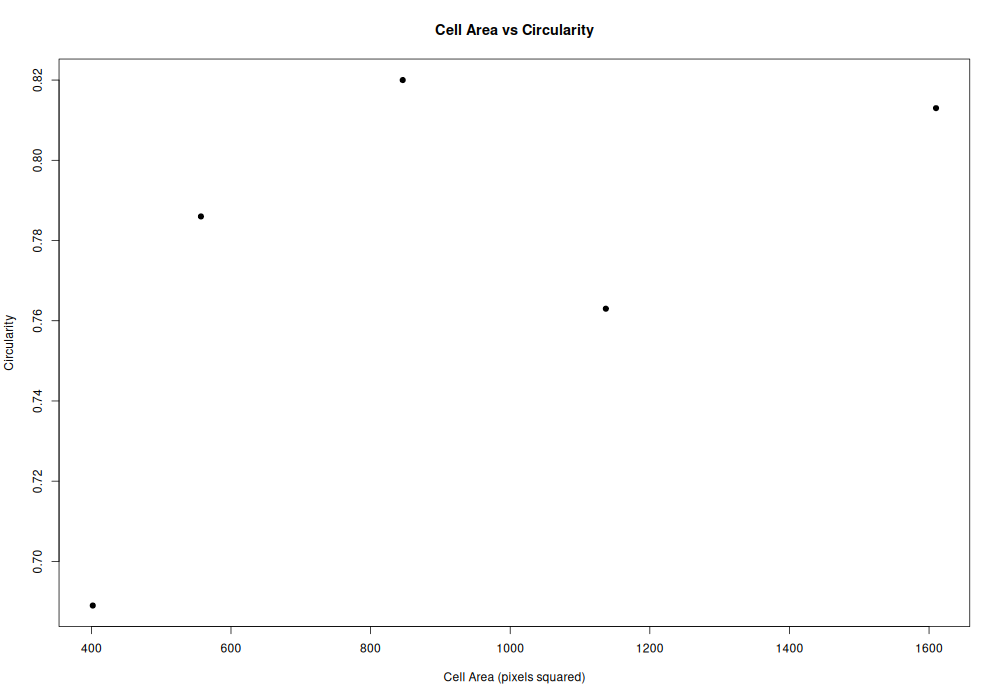
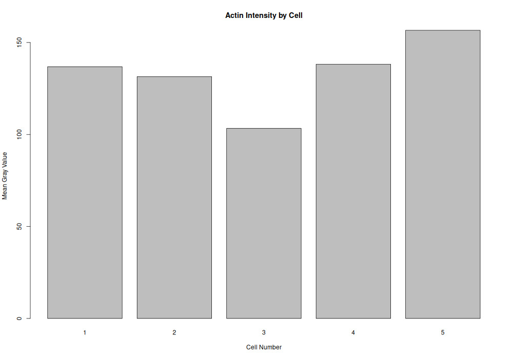

# Cytoskeleton and Cell Morphology
### BBBC018 Fluorescence Image Analysis Using Fiji/ImageJ and R

## Student Information

- **Student Name:** Klea Mae G. Estrellanes
- **Student ID:** 202400728
- **Course/Section:** BS Biology
- **Chosen Phenotype:** Actin Blebs
- **Image-Field ID:** 15962

---

## 1. Introduction

The cytoskeleton is a network of protein filaments that helps maintain cell shape and contributes to cell movement. This laboratory activity examines cell morphology and F-actin staining using fluorescence images of HT29 human colon cancer cells from the Broad Bioimage Benchmark Collection (BBBC018).

The objectives were to select a cell phenotype, measure five cells using Fiji/ImageJ, analyze the measurements using R, generate two plots, and document the results in GitHub.

The images used in this activity are fixed fluorescence images, not live-cell recordings. Therefore, the analysis focuses on cell structure and F-actin staining rather than directly measuring cell movement or migration speed.

## 2. Dataset and Image Selection

The images were obtained from the BBBC018 dataset.

- **Dataset page:** [BBBC018 — Broad Bioimage Benchmark Collection](https://bbbc.broadinstitute.org/BBBC018)
- **Direct download:** [BBBC018_v1_images.zip](https://data.broadinstitute.org/bbbc/BBBC018/BBBC018_v1_images.zip)
- **Image-field ID:** `15962`
- **Actin image:** `15962-actin.DIB`
- **DNA image:** `15962-DNA.DIB`

The actin channel was used to examine F-actin staining and cell boundaries, while the DNA channel helped identify the nuclei.

### Selected Phenotype: Actin Blebs

The selected phenotype was visually classified as **Actin Blebs** based on rounded, bubble-like protrusions observed along some cell boundaries in the actin fluorescence image. These visible features were used as the basis for the classification.

The phenotype is a visual interpretation rather than a verified label supplied by the image filename. The image-field ID identifies the image field, not its phenotype.

## 3. Materials and Methods

### 3.1 Image Examination

The actin image and its corresponding DNA image were examined using Fiji/ImageJ. The actin channel was used to observe F-actin staining and cell outlines. The DNA channel served as a reference for identifying nuclei.

### 3.2 Cell Measurement

### Fiji Measurement Procedure

1. Open the selected actin image in Fiji/ImageJ and use the corresponding DNA image as a reference.
2. Select five identifiable cells and outline each cell using the Freehand Selection tool.
3. Measure the area, mean gray value, circularity, and aspect ratio of each selected cell.
4. Save the measurements as a CSV file.
5. Save the annotated image showing the measured cells.
   
Five identifiable cells were selected and outlined using the Freehand Selection tool in Fiji/ImageJ. The measurements included:

- **Area:** The size of the outlined cell in pixels squared.
- **Mean gray value:** The average image intensity within the selected region.
- **Circularity:** A measure of how closely the cell outline resembles a circle. Values closer to 1 indicate a more circular shape.
- **Aspect ratio:** The ratio of the major axis to the minor axis of the fitted ellipse. Larger values generally indicate greater elongation.

The measurements were exported to CSV format for analysis.

### 3.3 Data Analysis

R was used to summarize the measurements and generate two plots: cell area versus circularity and mean actin fluorescence intensity. The results were interpreted descriptively.

Area is reported in pixels squared because no verified spatial calibration was provided. Fluorescence intensity is expressed in arbitrary image units and should not be interpreted as an absolute measurement of actin concentration.

## 4. Results

### 4.1 Summary of Measurements

The five measured cells had the following mean values:

| Measurement | Mean value |
|---|---:|
| Number of cells measured | 5 |
| Mean cell area | 910.4 pixels² |
| Mean circularity | 0.7742 |
| Mean aspect ratio | 1.3644 |
| Mean actin fluorescence intensity | 133.2934 arbitrary units |

The measurements showed variation in cell area, circularity, aspect ratio, and mean actin fluorescence intensity. The mean circularity of 0.7742 and mean aspect ratio of 1.3644 suggest that the cell outlines were generally closer to round than strongly elongated, although they were not perfectly circular.

### 4.2 Figure 1. Cell Area versus Circularity

This plot shows the relationship between the measured area and circularity of the five selected cells. Circularity values closer to 1 indicate more circular outlines, while lower values indicate less circular or more irregular outlines.

[View area_vs_circularity.png](figures/area_vs_circularity.png)

### 4.3 Figure 2. Mean Actin Fluorescence Intensity

This plot compares the mean actin fluorescence intensity measured in each selected cell. The values represent image intensity in arbitrary units.

[View actin_intensity.png](figures/actin_intensity.png)

### 4.4 Fiji Measurement Image

The image below documents the five selected cells outlined for measurement in Fiji/ImageJ.

## 5. Guide Questions

### 1. Which specific phenotype did you choose, and what visible features support that choice?

I selected the **Actin Blebs** phenotype because rounded, bubble-like protrusions were visible along some cell boundaries in the actin fluorescence image. These visible features served as the basis for my visual classification.

### 2. Were your five cells mostly round or elongated? Refer to your circularity and aspect-ratio results.

The five cells were generally closer to round than strongly elongated, although some variation in shape was observed. Their mean circularity was 0.7742 and their mean aspect ratio was 1.3644, indicating that the outlines were not perfectly circular and showed some elongation.

### 3. What role does actin play in maintaining cell shape and in cell movement?

Actin filaments help maintain cell shape by forming part of the cell cortex beneath the plasma membrane. They also contribute to cell movement by generating forces that help the cell change shape and extend its membrane.

### 4. Why can a single fixed fluorescence image NOT show how fast a cell moves?

A fixed fluorescence image captures the cell at one point in time and cannot show changes in its position over time. Measuring movement speed requires observations at multiple time points, such as through live-cell imaging.

## 6. Project Files

The following files are available in this GitHub repository:

| File | Description |
|---|---|
| [fiji_results.csv](fiji_results.csv) | Fiji/ImageJ measurements of the five selected cells |
| [cell_summary.csv](cell_summary.csv) | Numerical summary of the measurements |
| [analyze_cells.R](analyze_cells.R) | R script used for data analysis and plotting |
| [area_vs_circularity.png](figures/area_vs_circularity.png) | Cell area versus circularity plot |
| [actin_intensity.png](figures/actin_intensity.png) | Mean actin fluorescence intensity plot |
| [measured_cells.png](figures/measured_cells.png) | Fiji screenshot showing the outlined cells |

## 7. Conclusion

This activity demonstrated how fluorescence microscopy and image analysis can be used to examine cell morphology and F-actin staining. Measurements from five cells showed variation in cell area, circularity, aspect ratio, and mean actin fluorescence intensity.

The selected image was visually classified as Actin Blebs based on its observed features. The measurements describe the shapes and fluorescence signals of the selected cells, while the fixed image provides only a snapshot of their structure and cannot directly establish cell movement or migration speed.

## 8. References and Data Credit

Karp, G. *Cell and Molecular Biology: Concepts and Experiments*. Chapter 9: The Cytoskeleton and Cell Motility.

Data credit: “We used image set BBBC018v1 from the Broad Bioimage Benchmark Collection (Ljosa et al., Nature Methods, 2012).”

- **Dataset:** [Broad Bioimage Benchmark Collection — BBBC018](https://bbbc.broadinstitute.org/BBBC018)
- **Data license:** CC BY-NC-SA 3.0.
